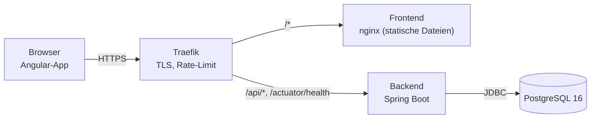
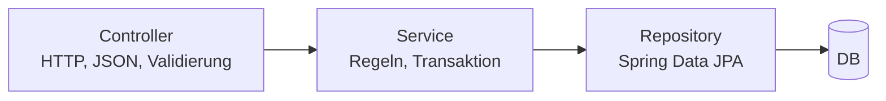

# Zutrittskontrolle – Spielhalle Musterstadt (Demo)

> **Demo mit erfundenen Daten.** Alle Namen, Personen und die Spielhalle sind ausgedacht.
> Die Daten werden jede Nacht um 3 Uhr (deutsche Zeit) zurückgesetzt.

Eine kleine, aber vollständige Web-Anwendung: Ein **Eingangsterminal** prüft, ob ein Spieler die Spielhalle betreten darf.
Das **Personal** verwaltet Spieler und kann sie sperren. Jeder Zutrittsversuch wird **protokolliert**.

Live-Demo: `https://[DOMAIN]` · Quellcode: <https://github.com/beklife/zutrittskontrolle>

## Warum?

In Deutschland müssen Spielhallen am Eingang zwei Dinge prüfen:

1. **Alter**: Personen unter 18 Jahren dürfen nicht hinein (Jugendschutz).
2. **Spielersperre**: Gesperrte Spieler (Selbst- oder Fremdsperre) dürfen nicht spielen.

Dieses Projekt bildet genau diesen Ablauf vereinfacht nach: Prüfen, Entscheiden, Protokollieren.

## Funktionen

| Seite | Was man dort tun kann |
|---|---|
| **Eingang** (`/eingang`) | Spieler wählen → „Prüfen“ → großes Ergebnis: *Zutritt erlaubt* / *Zutritt verweigert: unter 18* / *Zutritt verweigert: gesperrt* |
| **Verwaltung** (`/verwaltung`) | Spielerliste, Spieler sperren/entsperren, neuen Spieler anlegen (mit Validierung) |
| **Protokoll** (`/protokoll`) | Alle Zutrittsversuche eines Tages, Datum frei wählbar |
| **Über** (`/ueber`) | Kurze Projektbeschreibung, Architektur, Technik |

### Regeln

1. Spieler ist **gesperrt** → verweigert, Grund `BLOCKED`
2. Spieler ist **unter 18** → verweigert, Grund `UNDERAGE`
3. sonst → erlaubt, Grund `GRANTED`

**Gesperrt hat Vorrang.** Ist jemand minderjährig *und* gesperrt, lautet der Grund `BLOCKED`.
Eine Sperre ist eine bewusste Entscheidung des Personals und bleibt auch nach dem 18. Geburtstag gleich.
Diese Regel ist im Code dokumentiert und getestet (`AccessCheckServiceTest.blockedAndUnderage_blockedWins`).

## Architektur



Im Backend gibt es drei Schichten:



- **Controller** kennen nur DTOs (Java Records). **Entities verlassen nie die Service-Schicht.**
- Fehler werden zentral im `GlobalExceptionHandler` in **ProblemDetail** (RFC 9457) umgewandelt.

### Projektstruktur

```
backend/     Spring Boot (Java 21, Maven)       -> de.musterstadt.zutritt.{player, access, demo, config, common}
frontend/    Angular (Standalone, Signals)      -> src/app/{core, pages/*}, e2e/ (Playwright)
deploy/      Dockerfiles, nginx.conf, docker-compose.prod.yml, .env.example
docker-compose.yml   nur PostgreSQL für die lokale Entwicklung
```

### REST-API

| Methode | Pfad | Beschreibung |
|---|---|---|
| GET | `/api/players` | alle Spieler |
| POST | `/api/players` | Spieler anlegen (Namen 1–50 Zeichen, Geburtsdatum in der Vergangenheit) → 201 |
| PUT | `/api/players/{id}/block` | Body `{"blocked": true}` → sperren/entsperren |
| POST | `/api/access-checks` | Body `{"playerId": 1}` → 201 `{granted, reason, playerName, attemptedAt}` |
| GET | `/api/access-attempts?date=2026-10-22` | Versuche eines Tages (Europe/Berlin), ohne `date` = heute |

Fehler: `400` (Validierung, mit Feld-Fehlern unter `errors`), `404` (unbekannter Spieler), immer als `application/problem+json`.
Swagger UI lokal: <http://localhost:8080/swagger-ui.html> (in Produktion abgeschaltet).

## Lokal starten

Voraussetzungen: Java 21, Node 24, Docker.

```bash
# 1. Datenbank starten (PostgreSQL 16 auf Port 5433)
docker compose up -d

# 2. Backend starten (http://localhost:8080) – legt beim ersten Start die Demo-Daten an
cd backend && ./mvnw spring-boot:run

# 3. Frontend starten (http://localhost:4200) – /api wird an das Backend weitergeleitet
cd frontend && npm install && npm start
```

### Tests

```bash
cd backend  && ./mvnw verify      # Unit-, Controller- und Integrationstests (Testcontainers braucht Docker)
cd frontend && npm run lint && npm run build
cd frontend && npm run e2e        # Playwright + axe (Backend muss laufen)
```

| Testart | Werkzeug | Beispiel |
|---|---|---|
| Unit | JUnit 5, Mockito, AssertJ | `AccessCheckServiceTest` – alle Regeln, Schaltjahr, Zeitzone |
| Web-Schicht | MockMvc (`@WebMvcTest`) | `PlayerControllerTest` – 400/404 als ProblemDetail |
| Repository | `@DataJpaTest` + Testcontainers | `AccessAttemptRepositoryTest` – Zeitraum-Abfrage |
| Integration | `@SpringBootTest` + Testcontainers | `AccessFlowIntegrationTest` – HTTP bis DB |
| E2E + Barrierefreiheit | Playwright, axe-core | `e2e/zutritt.spec.ts`, `e2e/accessibility.spec.ts` |

## Deployment

Ein bestehender **Traefik** (mit Let's Encrypt) leitet die Anfragen weiter:

```bash
cd deploy
cp .env.example .env      # DOMAIN, TRAEFIK_NETWORK, CERT_RESOLVER, Datenbank-Passwort eintragen
docker compose -f docker-compose.prod.yml up -d --build
```

- `/api/*` → Backend (mit **Rate-Limit**), `/actuator/health` → Backend, alles andere → Frontend
- HTTP wird auf HTTPS umgeleitet
- Backend läuft als **Nicht-Root-User**, mit Docker-**Healthcheck**
- Swagger UI ist in Produktion aus (Profil `prod`)
- Geheimnisse nur in `.env` (nicht im Git). Im Repo liegt nur `.env.example`.

**CI:** GitHub Actions (`.github/workflows/ci.yml`) führt `mvn verify`, Frontend-Lint und -Build und die Playwright-Tests aus.

## Designentscheidungen

| Entscheidung | Warum |
|---|---|
| **`Clock` wird injiziert** | Die Regeln hängen von „heute“ ab. Im Test setze ich eine feste Uhr (`Clock.fixed`), so sind die Tests immer gleich, auch für Grenzfälle wie den 18. Geburtstag oder den 29. Februar. |
| **Zeitzone Europe/Berlin, Speicherung als `timestamptz` / `Instant`** | Gespeichert wird ein eindeutiger Zeitpunkt (UTC). Die Zeitzone wird nur für „welcher Tag ist heute?“ und „alle Versuche vom 22.10.“ gebraucht. So gibt es keine Fehler bei Sommer-/Winterzeit. |
| **ProblemDetail (RFC 9457)** | Ein Standardformat für alle Fehler. Das Frontend kann Fehler immer gleich behandeln. |
| **Grund als Enum (`AccessReason`)** | Nur drei erlaubte Werte, vom Compiler geprüft. In der DB zusätzlich per `CHECK`-Constraint abgesichert. Als Text gespeichert (`EnumType.STRING`), damit eine neue Reihenfolge im Enum die Daten nicht kaputt macht. |
| **Regel-Reihenfolge: gesperrt vor minderjährig** | Klar definiert und getestet (siehe oben). |
| **Flyway statt `ddl-auto=update`** | Das Schema ist versioniert und überall gleich. Hibernate prüft nur (`validate`). |
| **Index auf `access_attempt.attempted_at`** | Das Protokoll fragt immer einen Zeitraum ab. Der Index macht das schnell und liefert die Daten schon sortiert. |
| **Constructor Injection, keine Lombok** | Abhängigkeiten sind sichtbar, Felder `final`, Klassen ohne Spring testbar. |
| **Demo-Reset mit Schalter `app.demo.enabled`** | Start-Seeding und nächtlicher Reset nutzen denselben Code. Der Reset löscht alle Daten, deshalb muss er bewusst eingeschaltet sein. |

## Was ich als Nächstes verbessern würde

- **Login und Rollen mit Keycloak** (OAuth2/OIDC): Personal darf verwalten, das Terminal darf nur prüfen.
- **Audit-Log**: Wer hat wann einen Spieler gesperrt? (z. B. eigene Tabelle oder Hibernate Envers)
- **Offline-fähiges Terminal**: Sperrliste lokal zwischenspeichern, Prüfungen offline puffern und später senden.
- **Event-basierte Kommunikation mit Geräten** (z. B. MQTT oder Kafka): Terminals und Türöffner bekommen Änderungen sofort.
- Echte Ausweisprüfung statt Auswahl aus einer Liste.

## Hinweis

Demo-Projekt. Keine echten Firmen, Logos oder personenbezogenen Daten.
